# WorldFactory

An AI entertainment studio: one prompt becomes a living franchise, with twelve studios building from one versioned canon.

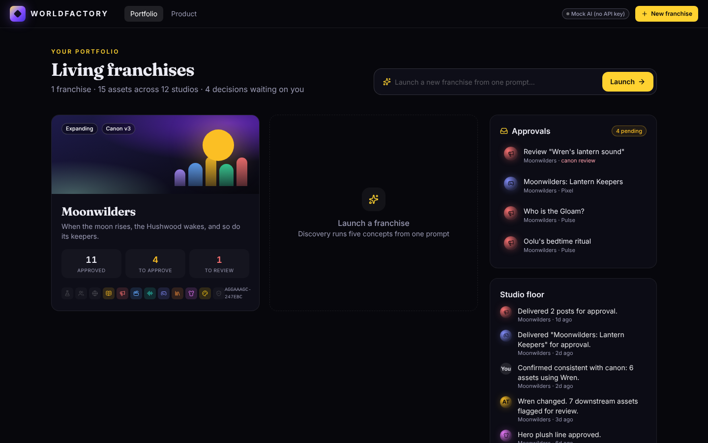

## Milestone 1

- **Landing page** (`/`): hero with a prompt bar, the 12 studios, the virtual studio team, the pipeline and pricing.
- **Studio home** (`/studio`): a portfolio of living franchises with the cross-portfolio approvals and activity feeds.
- **One-prompt launch** (`/studio/new`): Discovery (5 concepts) -> pick -> creative development -> greenlight to canon v1.
- **Franchise workspace** (`/studio/f/:id/:section`) with all 12 studios:
  - **Full depth:** IP Lab, Character Studio, World Builder, Social Studio and IP Vault, plus IP Bible export (Markdown, JSON, print/PDF).
  - **Lighter:** Story Room, Animation, Music & Sound, Games, Publishing, Merch & Licensing and Brand. Each lets you pick a deliverable kind, generate it from canon and approve it.
  - **IP Genome** (trait radar and lineage) and **Franchise Simulator** (audience, revenue and breakeven sliders).
- **Studio Director:** Atlas drafts a phased plan, and each task runs through a department agent and lands in the **approvals queue**.
- **Canon versioning:** every greenlight or edit to the core, cast or world is a new canon version, hashed into the Vault ledger. Editing a character flags every asset that depends on them as **Needs review** and queues a canon review for the owning department.
- **Seed demo franchise:** *Moonwilders*, at canon v3 with 15 assets, a plan, vault records and pending approvals.

## Stack

Next.js 16 (App Router) + TypeScript + Tailwind CSS 4 + Framer Motion + lucide-react.

## Running it

```bash
npm install
npm run dev            # http://localhost:3000
```

The app runs fully without an API key. Every AI route falls back to a deterministic mock generator (`lib/ai/mock.ts`), so the same input always gives the same output.

To use Claude, set `ANTHROPIC_API_KEY` (see `.env.example`). The top bar shows which mode is active, and so does `GET /api/health`. Set `WORLDFACTORY_MOCK=1` to force the mock while a key is present.

## Architecture

| Path | What it does |
| --- | --- |
| `app/api/ai/[task]/route.ts` | One server route per AI task: `discovery`, `develop`, `character`, `world`, `studio`, `social`, `director` |
| `lib/ai/tasks.ts` | Calls `@anthropic-ai/sdk` with `client.messages.parse` + `zodOutputFormat` on model `claude-opus-5-5`. Falls back to the mock if there's no key, the call errors, or Claude refuses |
| `lib/ai/schemas.ts` | Zod schemas for each task's structured output |
| `lib/ai/mock.ts` | Deterministic mock generators |
| `lib/franchise.ts` | Domain logic: canon versioning and hashing, downstream review flagging, approvals, Director plans, Genome, Simulator, Bible export |
| `lib/repository.ts` | `FranchiseRepository` interface + `LocalStorageFranchiseRepository` |
| `lib/seed.ts` | The Moonwilders demo franchise |
| `supabase/migrations/` | Postgres schema with row-level security, ready for a Supabase repository |

### Data

Milestone 1 stores everything in `localStorage` behind `FranchiseRepository`. Use "Reset demo data" on `/studio` to restore Moonwilders.

`supabase/migrations/20261017000000_worldfactory_init.sql` defines the target schema:
- franchises, characters, assets, approvals, vault records and activity, all owner-scoped through RLS;
- an append-only canon ledger.

A `SupabaseFranchiseRepository` can implement the same interface later.

### Canon and review flow

1. Each asset records `dependsOn` (character, location or rule ids) and the `canonVersion` it was approved against.
2. `commitEntityChange()` bumps the canon version and hashes the new canon. It then marks every non-draft dependent asset `needs_review` and queues a review approval for that studio.
3. In the queue, **Still canon** re-approves the asset against the new version; **Rework** sends it back to draft.

## Screenshots

`node scripts/screenshots.mjs http://localhost:3000` drives the main flows and writes PNGs to `docs/screenshots/` (it needs a running server). The script includes a character edit that flags downstream assets.

| | |
| --- | --- |
| 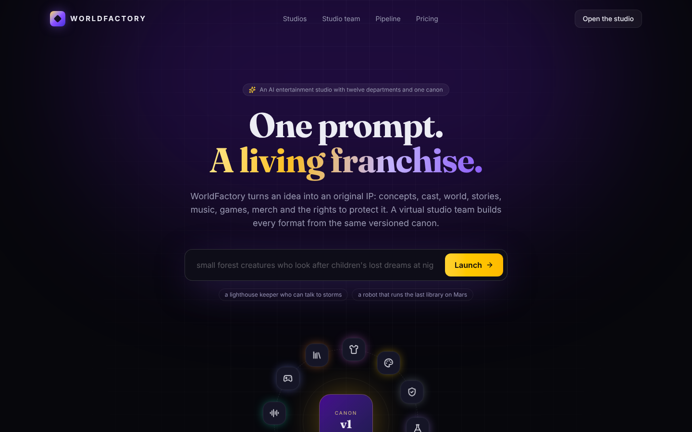 | 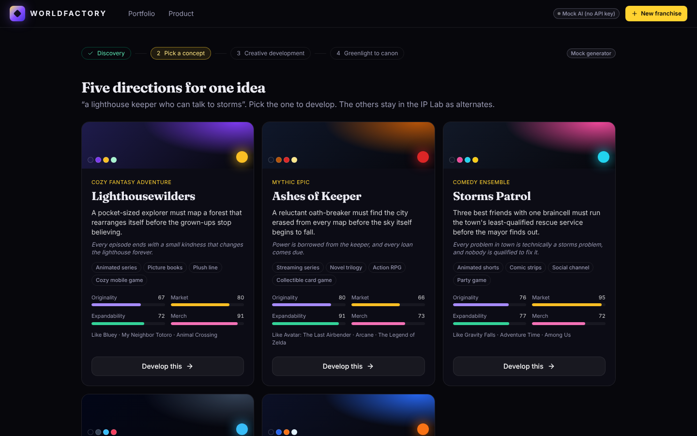 |
| 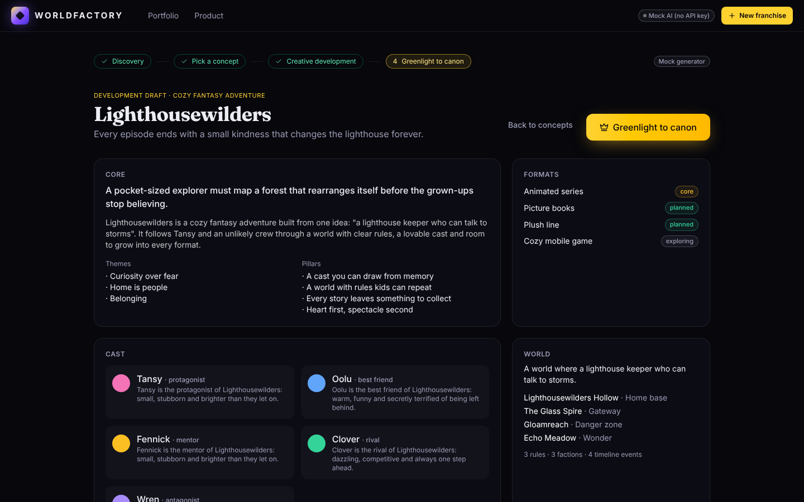 | 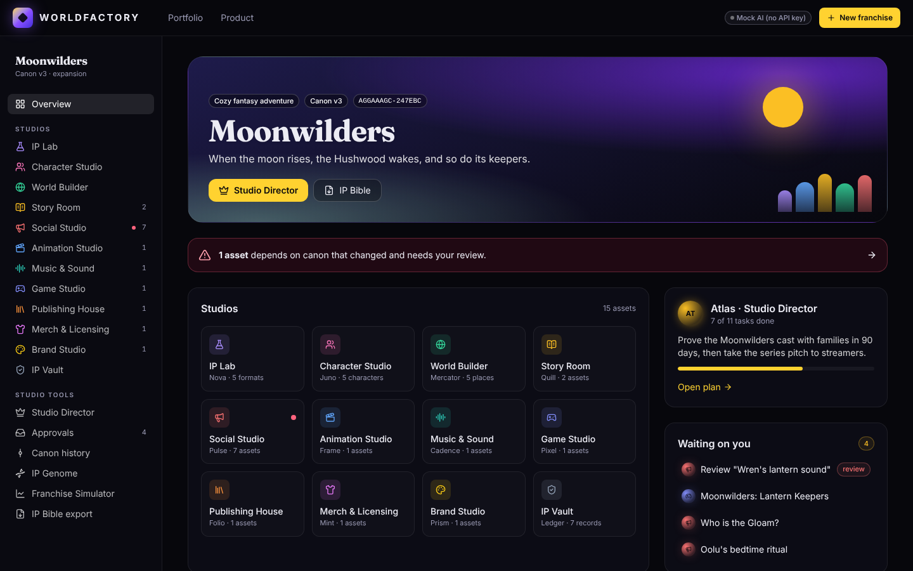 |
| 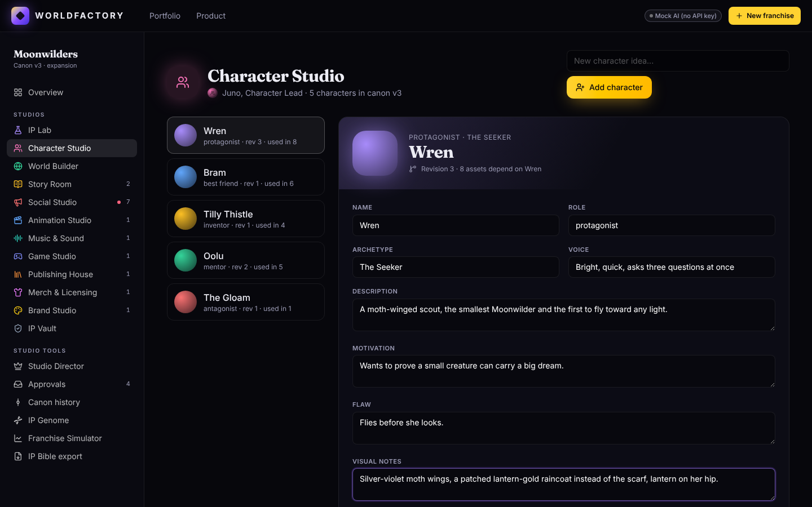 | 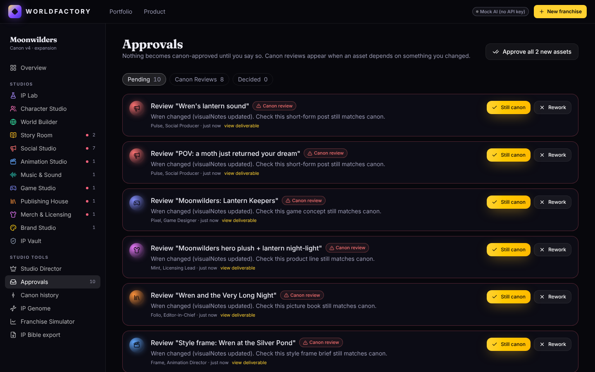 |
| 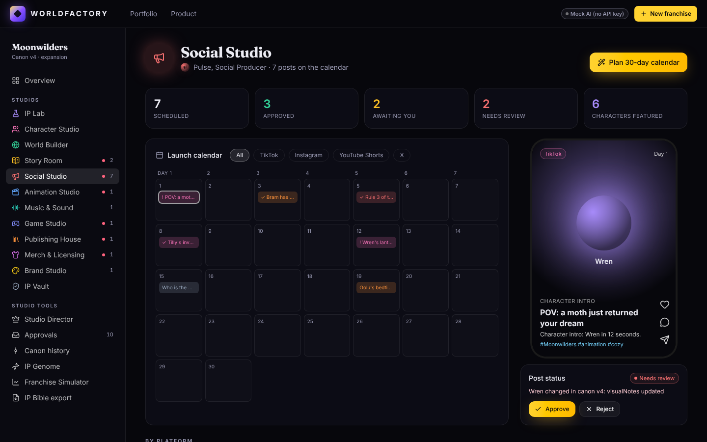 | 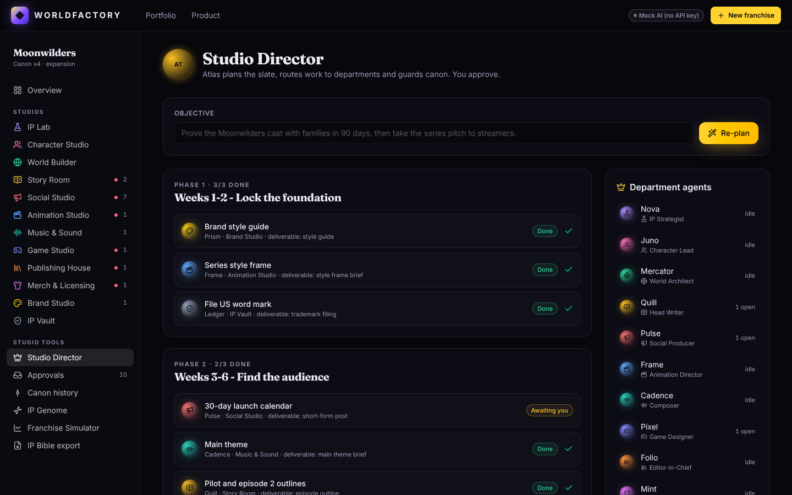 |
| 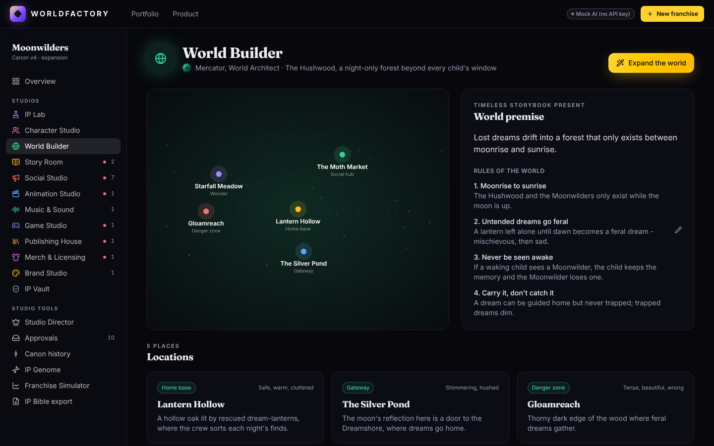 | 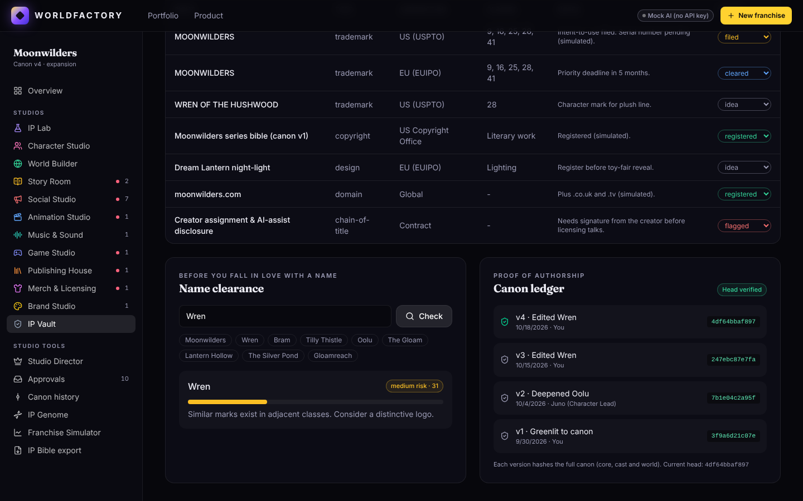 |

Trademark searches, filings and the simulator are simulated planning aids, not legal or financial advice.
