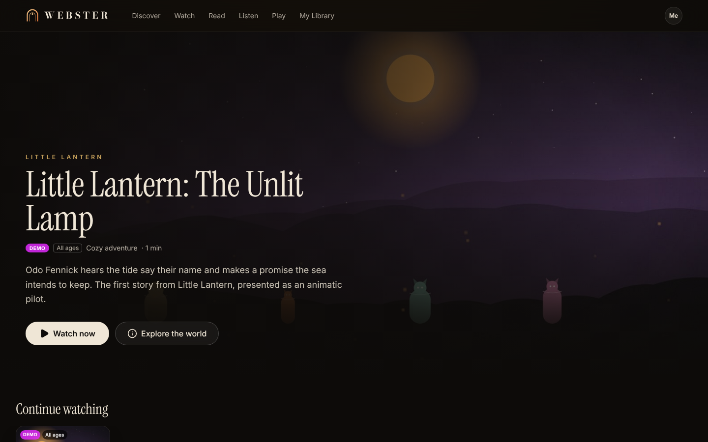

# WEBSTER

WEBSTER is an entertainment company built on an autonomous AI studio. Its original worlds, characters and stories are made by a durable, auditable production engine, and released to audiences on **WEBSTER WORLD**. The founder directs the studio from **WEBSTER OS**.



**This is a working system.** One brief goes all the way through, persisted at every step:

1. Concepts are generated, scored and greenlit.
2. The canon bible, pilot script, storyboard and an FFmpeg animatic are produced.
3. QA reviews the result and the founder approves it.
4. It's published to WEBSTER WORLD.
5. Real audience events come back in.
6. A statistically honest experiment proposal follows.

See [`docs/ARCHITECTURE.md`](docs/ARCHITECTURE.md) for the design, data model, integration matrix and phased plan.

## Quick start

Requirements:

* Node 22
* PostgreSQL 16
* FFmpeg with libx264, libvpx-vp9, libopus and libass

```bash
cp .env.example .env            # set DATABASE_URL (and optionally provider keys)
npm install                     # also runs `prisma generate`
npm run db:migrate              # apply migrations
npm run db:seed                 # settings, founder account, agents, channels, schedules
npm run dev:all                 # web app + engine worker
```

* WEBSTER WORLD: http://localhost:3000
* WEBSTER OS: http://localhost:3000/os. Sign in with `WEBSTER_FOUNDER_EMAIL` / `WEBSTER_FOUNDER_PASSWORD`; the seed defaults to `founder@webster.studio` / `webster-dev`.

In production, run `npm run build && npm start`, plus one or more `npm run worker` processes.

### Try the slice

In **Founder Copilot**, type:

> Develop five original fantasy franchises for young adults and prototype the two strongest concepts.

Then:

1. Watch it on the **Studio Floor**.
2. Greenlight two concepts in the **Approval Inbox**.
3. Approve the two publications.
4. Open WEBSTER WORLD.

After people watch, use **Intelligence → Review now** to get findings and an experiment proposal.

**Expansion (Phase 2).** Use a franchise's **Director & roadmap → Start development cycle**, or turn on the flywheel in Settings. Franchise Development proposes episodes, comics and interactive stories with measured cost estimates. You pick what to make, and each production ships through its own QA and publication gates. Character edits go through canon-change approval and flag dependent assets for review.

`npm run slice` (and `node scripts/phase2.mjs` for expansion) drives all of this in a browser and writes screenshots to `docs/screenshots/`. It needs a running app and worker. Its viewer sessions are tagged as QA traffic.

## Without API keys

Everything runs. Writing agents use a **deterministic DEMO generator**, which you can turn off in Settings:

* It is labelled DEMO everywhere: OS, WORLD, disclosures and the database.
* It is never published to external platforms.

Storyboards and key art come from WEBSTER's in-house **procedural renderer**. It isn't AI generation, and it's labelled as such.

Add `ANTHROPIC_API_KEY` (or store it encrypted from Settings) for real writing on `claude-opus-5-5`. Add OpenAI, ElevenLabs and YouTube credentials to enable AI imagery, licensed voices and external publishing. Missing integrations are never faked: their jobs block with setup instructions, or their publications are recorded as skipped.

## Tests & CI

```bash
npm test          # unit + integration tests against Postgres (TEST_DATABASE_URL) with real FFmpeg
npm run typecheck
npm run build
```

The integration tests cover:

* queue leasing, retry and dead-lettering;
* budget caps and the circuit breaker;
* workflow retry, block and resume;
* missing-credential blocking;
* autonomy policy;
* the full vertical slice, from brief to experiment proposal.

CI runs on GitHub Actions with a Postgres service.

## Layout

```
app/(world)/       WEBSTER WORLD (consumer)
app/os/            WEBSTER OS (founder command center) + server actions
app/api/           media (Range), world events, auth
engine/            workflows, queue, worker, metering, policy, canon, agents,
                   providers (llm/image/voice), media (ffmpeg/render), channels, analytics, learning
prisma/            schema, migrations, seed
tests/             vitest unit + integration
archive/worldfactory/  the earlier WorldFactory prototype (superseded by WEBSTER)
```
